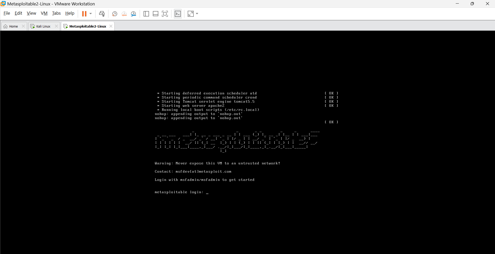
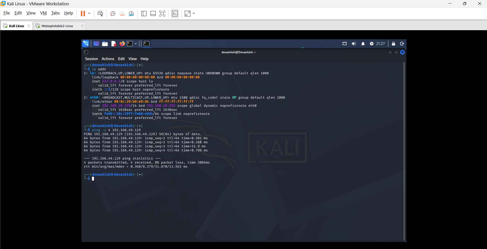

# 🔐 Bind & Reverse Shell Using Metasploit
## 📌 Project Overview
This project explores Bind TCP and Reverse TCP concepts using the Metasploit Framework in an isolated VMware lab environment.

## 🎯 Objectives
- Understand Bind TCP and Reverse TCP.
- Explore msfvenom payload concepts.
- Study Metasploit Multi/Handler.
- Understand Meterpreter.
- Learn post-exploitation concepts.
- Practice safe and authorized security testing.

## 🛠️ Tools Used
- VMware Workstation
- Kali Linux
- Metasploitable 2
- Metasploit Framework
- msfvenom
- Meterpreter

## 🖥️ Lab Environment
| Component | Configuration |
|---|---|
| Host OS | Windows |
| Virtualization | VMware Workstation |
| Testing Machine | Kali Linux |
| Target Machine | Metasploitable 2 |
| Network | Host-Only |

## 📚 Topics Covered
1. msfvenom Payload
2. Multi/Handler
3. Reverse TCP
4. Bind TCP
5. Meterpreter
6. Post Exploitation

## 💡 Learning Outcomes
- Understood TCP connection concepts.
- Explored Metasploit Framework.
- Learned about payload types and handlers.
- Studied Meterpreter capabilities.
- Understood post-exploitation analysis.

# 🖥️ Project Implementation

# 🖥️ Step 1: Download and Install VMware Workstation

## 📌 Description

I installed VMware Workstation Pro to create a virtual lab environment for the **Metasploit Bind and Reverse Shell Project**. VMware allows me to run virtual machines and perform practical cybersecurity exercises in an isolated environment.

## 🛠️ Installation Steps

1. Open the official [VMware Workstation Download Page](https://www.vmware.com/products/desktop-hypervisor/workstation-and-fusion).
2. Download VMware Workstation for Windows.
3. Open the downloaded installer.
4. Click **Next**.
5. Accept the license agreement.
6. Keep the default installation settings.
7. Click **Install**.
8. Restart Windows if the installer requests it.
9. Open VMware Workstation.

### VMware Workstation Installed Successfully


# 🖥️ Step 2: Download and Install Kali Linux

## 📌 Description

I downloaded the prebuilt Kali Linux VMware image and imported it into VMware Workstation to use as my security testing machine for the **Metasploit Bind and Reverse Shell Project**.

Kali Linux is a Debian-based Linux distribution designed for penetration testing, ethical hacking, and security auditing.

## 🛠️ Installation Steps

1. Open the official [Kali Linux Download Page](https://www.kali.org/get-kali/).
2. Select **Virtual Machines**.
3. Find the VMware image.
4. Download the 64-bit VMware archive.
5. Extract the downloaded archive using 7-Zip or another archive utility.
6. Open VMware Workstation.
7. Click **Open a Virtual Machine**.
8. Browse to the extracted Kali Linux folder.
9. Select the `.vmx` file and click **Open**.
10. Start the Kali Linux virtual machine.
11. Wait for Kali Linux to boot successfully.

### Kali Linux Installed Successfully


# 🎯 Step 3: Download and Install Metasploitable 2

## 📌 Description

I downloaded and imported Metasploitable 2 into VMware Workstation as an intentionally vulnerable target machine for controlled security testing.

Metasploitable 2 is a vulnerable Linux virtual machine developed by Rapid7. It is used to practice penetration testing, vulnerability assessment, and security testing in an isolated lab environment.

## 🛠️ Installation Steps

1. Open the [Official Metasploitable 2 Documentation](https://docs.rapid7.com/metasploit/metasploitable-2/).
2. Follow the download instructions.
3. Download the Metasploitable 2 archive.
4. Extract the downloaded archive.
5. Open VMware Workstation.
6. Select **File → Open**.
7. Browse to the extracted Metasploitable 2 folder.
8. Select the `.vmx` file.
9. Click **Open**.
10. Start the Metasploitable 2 virtual machine.
11. Wait for the login screen to appear.

## 🔐 Default Login Credentials

| Username | Password |
|----------|----------|
| `msfadmin` | `msfadmin` |

### Metasploitable 2 Installed Successfully



# 🌐 Step 4: Configure VMware Host-Only Network

## 📌 Description

I configured VMware Host-Only networking for Kali Linux and Metasploitable 2 to create an isolated virtual lab environment. This allows both virtual machines to communicate privately for the Metasploit Bind and Reverse Shell practical.

## 🎯 Objective

- Create an isolated virtual network.
- Connect Kali Linux and Metasploitable 2.
- Enable private communication between both machines.
- Secure the vulnerable target machine from external networks.

## 🛠️ Configuration Steps

### 1. Configure VMware Virtual Network

1. Shut down both virtual machines.
2. Open VMware Workstation.
3. Click **Edit → Virtual Network Editor**.
4. Select `VMnet1`.
5. Choose **Host-Only** network type.
6. Enable the local DHCP service if required.
7. Click **Apply → OK**.

### 2. Configure Kali Linux Network

1. Select Kali Linux in VMware.
2. Click **Edit Virtual Machine Settings**.
3. Select **Network Adapter**.
4. Choose **Custom: Specific virtual network**.
5. Select `VMnet1`.
6. Click **OK**.

### 3. Configure Metasploitable 2 Network

1. Select Metasploitable 2 in VMware.
2. Click **Edit Virtual Machine Settings**.
3. Select **Network Adapter**.
4. Choose **Custom: Specific virtual network**.
5. Select `VMnet1`.
6. Click **OK**.

## 💻 Network Verification Commands

### On Kali Linux

```bash
ip addr
```

### On Metasploitable 2

```bash
ifconfig
```

### Test Connectivity from Kali Linux

```bash
ping -c 4 <METASPLOITABLE-IP>
```
Replace <METASPLOITABLE-IP> with the actual IP address of Metasploitable 2.


