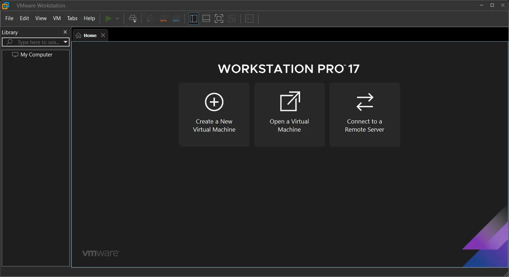
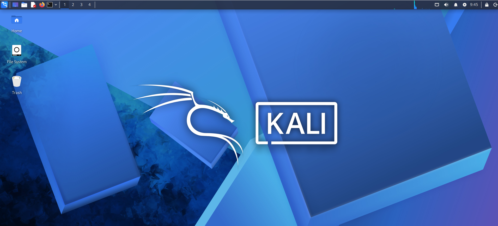

# 🔐 Bind & Reverse Shell Using Metasploit
## 📌 Project Overview
This project explores Bind TCP and Reverse TCP concepts using the Metasploit Framework in an isolated VMware lab environment.

## 🎯 Objectives
- Understand Bind TCP and Reverse TCP.
- Explore msfvenom payload concepts.
- Study Metasploit Multi/Handler.
- Understand Meterpreter.
- Learn post-exploitation concepts.
- Practice safe and authorized security testing.

## 🛠️ Tools Used
- VMware Workstation
- Kali Linux
- Metasploitable 2
- Metasploit Framework
- msfvenom
- Meterpreter

## 🖥️ Lab Environment
| Component | Configuration |
|---|---|
| Host OS | Windows |
| Virtualization | VMware Workstation |
| Testing Machine | Kali Linux |
| Target Machine | Metasploitable 2 |
| Network | Host-Only |

## 📚 Topics Covered
1. msfvenom Payload
2. Multi/Handler
3. Reverse TCP
4. Bind TCP
5. Meterpreter
6. Post Exploitation

## 💡 Learning Outcomes
- Understood TCP connection concepts.
- Explored Metasploit Framework.
- Learned about payload types and handlers.
- Studied Meterpreter capabilities.
- Understood post-exploitation analysis.

# 🖥️ Project Implementation

# 🖥️ Step 1: Download and Install VMware Workstation

## 📌 Description

I installed VMware Workstation Pro to create a virtual lab environment for the **Metasploit Bind and Reverse Shell Project**. VMware allows me to run virtual machines and perform practical cybersecurity exercises in an isolated environment.

## 🛠️ Installation Steps

1. Open the official [VMware Workstation Download Page](https://www.vmware.com/products/desktop-hypervisor/workstation-and-fusion).
2. Download VMware Workstation for Windows.
3. Open the downloaded installer.
4. Click **Next**.
5. Accept the license agreement.
6. Keep the default installation settings.
7. Click **Install**.
8. Restart Windows if the installer requests it.
9. Open VMware Workstation.

### VMware Workstation Installed Successfully

# 🖥️ Step 2: Download and Install Kali Linux

## 📌 Description

I downloaded the prebuilt Kali Linux VMware image and imported it into VMware Workstation to use as my security testing machine for the **Metasploit Bind and Reverse Shell Project**.

Kali Linux is a Debian-based Linux distribution designed for penetration testing, ethical hacking, and security auditing.

## 🛠️ Installation Steps

1. Open the official [Kali Linux Download Page](https://www.kali.org/get-kali/).
2. Select **Virtual Machines**.
3. Find the VMware image.
4. Download the 64-bit VMware archive.
5. Extract the downloaded archive using 7-Zip or another archive utility.
6. Open VMware Workstation.
7. Click **Open a Virtual Machine**.
8. Browse to the extracted Kali Linux folder.
9. Select the `.vmx` file and click **Open**.
10. Start the Kali Linux virtual machine.
11. Wait for Kali Linux to boot successfully.

### Kali Linux Installed Successfully

