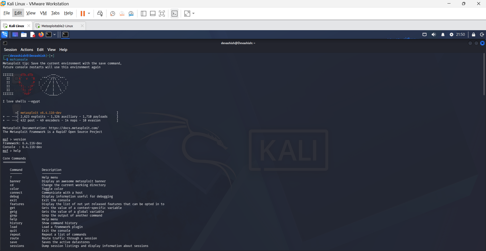
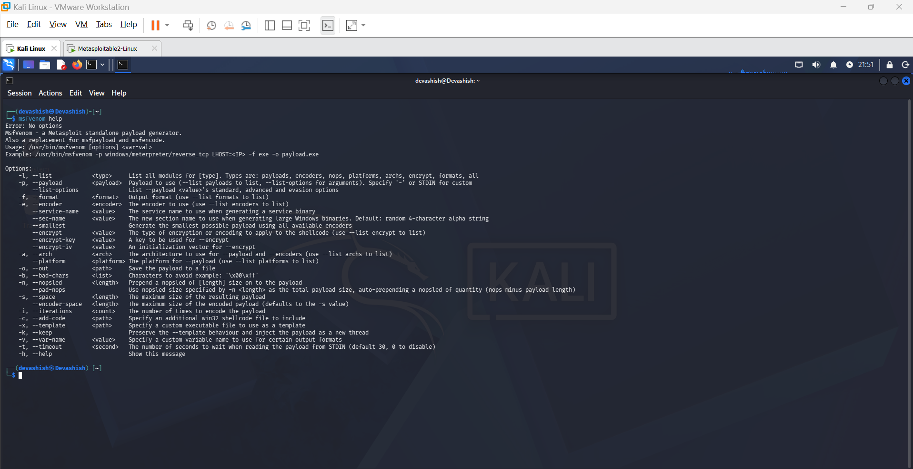
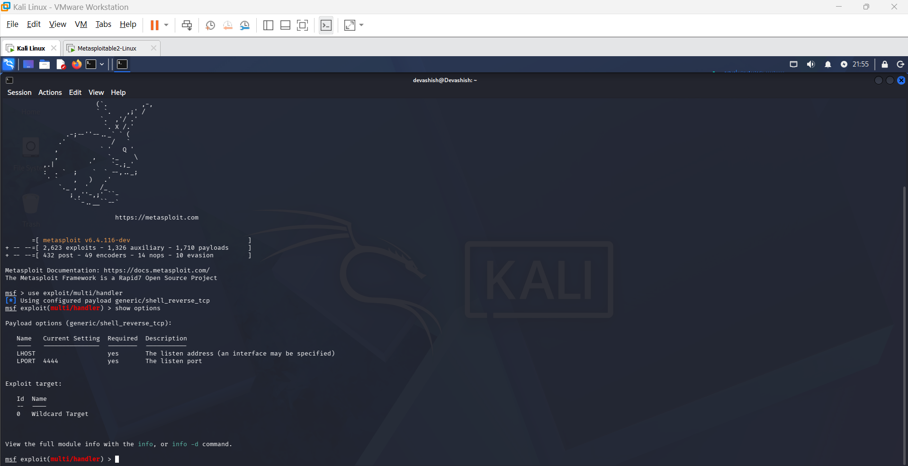
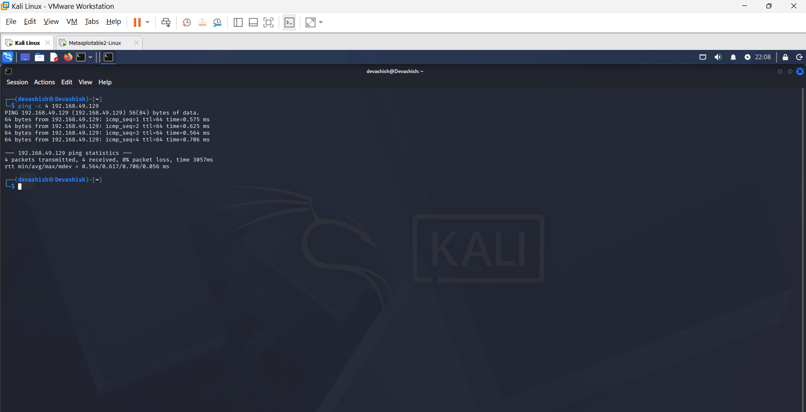
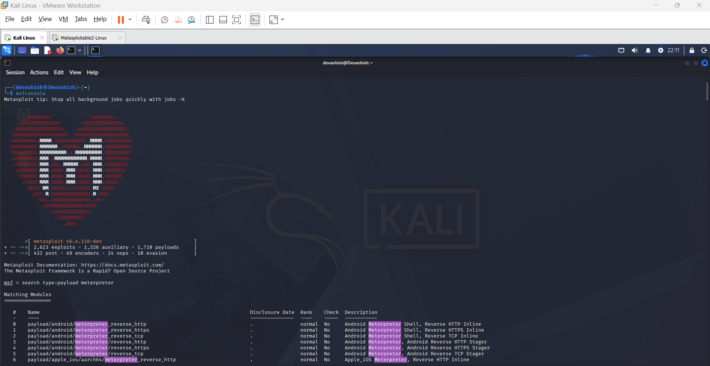
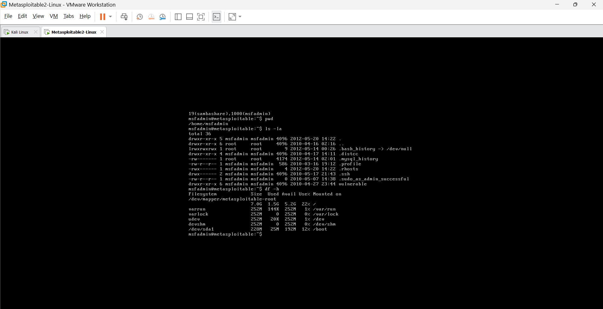

# 🔐 Bind & Reverse Shell Using Metasploit
## 📌 Project Overview
This project explores Bind TCP and Reverse TCP concepts using the Metasploit Framework in an isolated VMware lab environment.

## 🎯 Objectives
- Understand Bind TCP and Reverse TCP.
- Explore msfvenom payload concepts.
- Study Metasploit Multi/Handler.
- Understand Meterpreter.
- Learn post-exploitation concepts.
- Practice safe and authorized security testing.

## 🛠️ Tools Used
- VMware Workstation
- Kali Linux
- Metasploitable 2
- Metasploit Framework
- msfvenom
- Meterpreter

## 🖥️ Lab Environment
| Component | Configuration |
|---|---|
| Host OS | Windows |
| Virtualization | VMware Workstation |
| Testing Machine | Kali Linux |
| Target Machine | Metasploitable 2 |
| Network | Host-Only |

## 📚 Topics Covered
1. msfvenom Payload
2. Multi/Handler
3. Reverse TCP
4. Bind TCP
5. Meterpreter
6. Post Exploitation

## 💡 Learning Outcomes
- Understood TCP connection concepts.
- Explored Metasploit Framework.
- Learned about payload types and handlers.
- Studied Meterpreter capabilities.
- Understood post-exploitation analysis.

# 🖥️ Project Implementation

# 🖥️ Step 1: Download and Install VMware Workstation

## 📌 Description

I installed VMware Workstation Pro to create a virtual lab environment for the **Metasploit Bind and Reverse Shell Project**. VMware allows me to run virtual machines and perform practical cybersecurity exercises in an isolated environment.

## 🛠️ Installation Steps

1. Open the official [VMware Workstation Download Page](https://www.vmware.com/products/desktop-hypervisor/workstation-and-fusion).
2. Download VMware Workstation for Windows.
3. Open the downloaded installer.
4. Click **Next**.
5. Accept the license agreement.
6. Keep the default installation settings.
7. Click **Install**.
8. Restart Windows if the installer requests it.
9. Open VMware Workstation.

### VMware Workstation Installed Successfully


# 🖥️ Step 2: Download and Install Kali Linux

## 📌 Description

I downloaded the prebuilt Kali Linux VMware image and imported it into VMware Workstation to use as my security testing machine for the **Metasploit Bind and Reverse Shell Project**.

Kali Linux is a Debian-based Linux distribution designed for penetration testing, ethical hacking, and security auditing.

## 🛠️ Installation Steps

1. Open the official [Kali Linux Download Page](https://www.kali.org/get-kali/).
2. Select **Virtual Machines**.
3. Find the VMware image.
4. Download the 64-bit VMware archive.
5. Extract the downloaded archive using 7-Zip or another archive utility.
6. Open VMware Workstation.
7. Click **Open a Virtual Machine**.
8. Browse to the extracted Kali Linux folder.
9. Select the `.vmx` file and click **Open**.
10. Start the Kali Linux virtual machine.
11. Wait for Kali Linux to boot successfully.

### Kali Linux Installed Successfully


# 🎯 Step 3: Download and Install Metasploitable 2

## 📌 Description

I downloaded and imported Metasploitable 2 into VMware Workstation as an intentionally vulnerable target machine for controlled security testing.

Metasploitable 2 is a vulnerable Linux virtual machine developed by Rapid7. It is used to practice penetration testing, vulnerability assessment, and security testing in an isolated lab environment.

## 🛠️ Installation Steps

1. Open the [Official Metasploitable 2 Documentation](https://docs.rapid7.com/metasploit/metasploitable-2/).
2. Follow the download instructions.
3. Download the Metasploitable 2 archive.
4. Extract the downloaded archive.
5. Open VMware Workstation.
6. Select **File → Open**.
7. Browse to the extracted Metasploitable 2 folder.
8. Select the `.vmx` file.
9. Click **Open**.
10. Start the Metasploitable 2 virtual machine.
11. Wait for the login screen to appear.

## 🔐 Default Login Credentials

| Username | Password |
|----------|----------|
| `msfadmin` | `msfadmin` |

### Metasploitable 2 Installed Successfully


# 🌐 Step 4: Configure VMware Host-Only Network

## 📌 Description

I configured VMware Host-Only networking for Kali Linux and Metasploitable 2 to create an isolated virtual lab environment. This allows both virtual machines to communicate privately for the Metasploit Bind and Reverse Shell practical.

## 🎯 Objective

- Create an isolated virtual network.
- Connect Kali Linux and Metasploitable 2.
- Enable private communication between both machines.
- Secure the vulnerable target machine from external networks.

## 🛠️ Configuration Steps

### 1. Configure VMware Virtual Network

1. Shut down both virtual machines.
2. Open VMware Workstation.
3. Click **Edit → Virtual Network Editor**.
4. Select `VMnet1`.
5. Choose **Host-Only** network type.
6. Enable the local DHCP service if required.
7. Click **Apply → OK**.

### 2. Configure Kali Linux Network

1. Select Kali Linux in VMware.
2. Click **Edit Virtual Machine Settings**.
3. Select **Network Adapter**.
4. Choose **Custom: Specific virtual network**.
5. Select `VMnet1`.
6. Click **OK**.

### 3. Configure Metasploitable 2 Network

1. Select Metasploitable 2 in VMware.
2. Click **Edit Virtual Machine Settings**.
3. Select **Network Adapter**.
4. Choose **Custom: Specific virtual network**.
5. Select `VMnet1`.
6. Click **OK**.

## 💻 Network Verification Commands

### On Kali Linux

```bash
ip addr
```

### On Metasploitable 2

```bash
ifconfig
```

### Test Connectivity from Kali Linux

```bash
ping -c 4 <METASPLOITABLE-IP>
```
Replace <METASPLOITABLE-IP> with the actual IP address of Metasploitable 2.


# 🚀 Step 5: Open Metasploit Framework

## 📌 Description

I opened the Metasploit Framework console in Kali Linux and verified its installation, framework version, and available commands.

## 🛠️ Steps

1. Open Kali Linux.
2. Open Terminal.
3. Execute the command:

```bash
msfconsole
```

4. Wait for the Metasploit console to start.
5. Check the framework version:

```bash
version
```

6. View the available commands:

```bash
help
```

7. Exit the Metasploit console:

```bash
exit
```

### Metasploit Framework Console



# ⚙️ Step 6: Study MSFvenom Payload

## 📌 Description

I explored the MSFvenom utility in Kali Linux and studied its payload options, supported formats, architectures, and basic functionality.

MSFvenom is a Metasploit Framework tool used for generating payloads during authorized security testing.

## 🎯 Objectives

- Understand MSFvenom.
- Explore available command-line options.
- Study different payload types.
- Understand supported output formats.
- Learn supported architectures.
- Understand Bind TCP and Reverse TCP concepts.

## 🛠️ Practical Steps

### 1. Open Kali Linux
Start Kali Linux in VMware Workstation.

### 2. Open Terminal
Launch the Kali Linux terminal.

### 3. Display MSFvenom Help

Execute the following command:

```bash
msfvenom --help
```



# 🎯 Step 7: Study Multi/Handler and Reverse TCP

## 📌 Description

I studied the Metasploit Multi/Handler module and the working principle of Reverse TCP connections in an authorized penetration-testing environment.

## 🎯 Objectives

- Understand Multi/Handler.
- Learn about listening ports.
- Understand Reverse TCP connections.
- Study the role of the testing machine.
- Understand how a handler manages compatible connections.

## 📚 Concepts Studied

### 1. What is Multi/Handler?

Multi/Handler is a Metasploit module used to listen for and manage incoming compatible payload connections.

### 2. What is a Listening Port?

A listening port is a network port that waits for incoming connections.

Example: Port 4444.

### 3. What is Reverse TCP?

Reverse TCP is a connection method in which the target machine initiates a TCP connection towards the testing machine.

### 4. Role of Testing Machine

Kali Linux acts as the testing machine. It is used to run Metasploit and monitor incoming connections.

### 5. How Does a Handler Work?

The handler waits for incoming compatible connections and manages the associated sessions.

## 🔄 Reverse TCP Working Process

1. The testing machine prepares a listener.
2. The target initiates a TCP connection.
3. The handler receives a compatible connection.
4. Metasploit manages the established session.

## 💻 Practical Commands

### Start Metasploit

```bash
msfconsole
```

### Select Multi/Handler

```bash
use exploit/multi/handler
```

### View Available Options

```bash
show options
```

### Multi/Handler Concepts



# 🔗 Step 8: Study Bind TCP

## 📌 Description

I studied Bind TCP communication and understood how a target-side listening service receives an incoming connection from a testing machine.

## 🎯 Objectives

- Understand Bind TCP communication.
- Learn about listening ports.
- Understand the role of the target machine.
- Study how the testing machine initiates a connection.
- Compare Bind TCP with Reverse TCP.

## 📚 Concepts Studied

### 1. What is Bind TCP?

Bind TCP is a communication technique in which the target machine listens on a specific port and waits for an incoming TCP connection.

### 2. What is a Listening Port?

A listening port is a network port that waits for incoming connections from other devices.

### 3. Role of Target Machine

The target machine acts as a server and listens for incoming connections on a specific port.

### 4. Role of Testing Machine

The testing machine acts as a client and initiates a connection to the target machine.

### 5. Bind TCP vs Reverse TCP

| Bind TCP | Reverse TCP |
|---|---|
| Target machine listens | Testing machine listens |
| Testing machine initiates connection | Target initiates connection |
| Uses target-side listening port | Uses testing-side listening port |
| Incoming connection to target | Outgoing connection from target |

## 💻 Practical Commands

### Check Target IP Address

```bash
ifconfig
```

### Check Listening TCP Ports

```bash
netstat -tln
```

### Check Kali Linux IP Address
```bash
ip addr
```

### Bind TCP Concept



# 🖥️ Step 9: Study Meterpreter

## 📌 Description

I studied Meterpreter and its capabilities for system information, process analysis, network information, file system exploration, and session management.

Meterpreter is an advanced Metasploit payload that provides an interactive session for authorized security testing.

## 🎯 Objectives

- Understand Meterpreter.
- Study system information.
- Learn about running processes.
- Understand network information.
- Study file system operations.
- Understand session management.

## 📚 Meterpreter Features

| Feature | Purpose |
|---|---|
| System Information | Understand operating system details |
| Process Information | Understand running processes |
| Network Information | Understand network interfaces |
| File System | Understand files and directories |
| Session Management | Understand session handling |

## 💻 Important Meterpreter Commands

| Command | Description |
|---|---|
| `sysinfo` | Display system information |
| `getuid` | Display current user |
| `ps` | Display running processes |
| `ipconfig` | Display network information |
| `pwd` | Display current directory |
| `ls` | List files and directories |
| `help` | Display available commands |
| `background` | Background the current session |

## 🛠️ Practical Commands

### 1. Open Kali Linux Terminal

Start Metasploit Framework:

```bash
msfconsole
```

### 2. Search Meterpreter Payloads

```bash
search type:payload meterpreter
```

### 3. Explore Available Commands

```bash
help
```


# 🔍 Step 10: Study Post-Exploitation

## 📌 Description

I studied post-exploitation concepts and learned how system information, running processes, network configuration, user accounts, file systems, and session information are analyzed during authorized security testing.

## 🎯 Objectives

- Understand system information analysis.
- Study running processes.
- Analyze network configuration.
- Understand user account information.
- Study file-system analysis.
- Learn session management.

## 📚 Topics Studied

### 1. System Information Analysis
Understanding operating system details, hostname, and kernel version.

### 2. Running Process Analysis
Understanding currently running processes and system activities.

### 3. Network Configuration Analysis
Understanding IP addresses, network interfaces, and routing information.

### 4. User Account Information
Understanding system users and account details.

### 5. File-System Analysis
Understanding files, directories, and disk usage.

### 6. Session Management
Understanding active sessions, session status, and session handling.

## 💻 Practical Commands

### 1. System Information

```bash
uname -a
hostname
```

### 2. Running Processes

```bash
ps aux
top
```

### 3. Network Information
```bash
ifconfig
netstat -rn
```

### 4. User Information

```bash
whoami
id
```

### 5. File-System Information

```bash
pwd
ls -la
df -h
```

### Post-Exploitation Analysis


